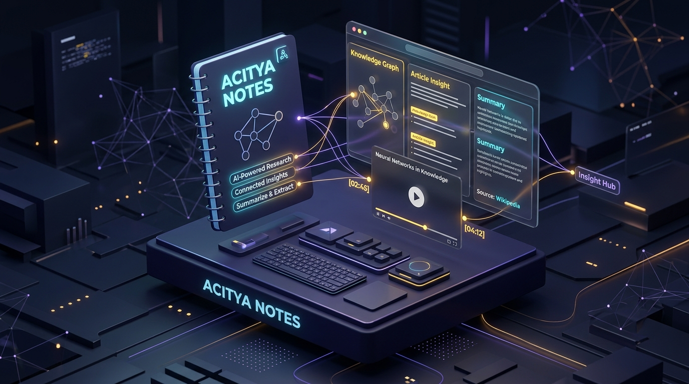
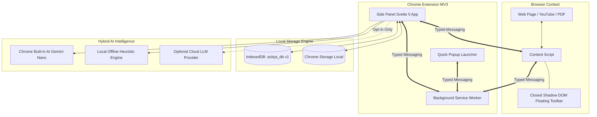

<div align="center">

# Anitya (Acitya Notes) 🧠✨

**Privacy-First AI Browser Notetaker for Web, PDF, and YouTube**  
*Berakar dari kata Sansekerta/Kawi "Acitya" (Ilmu Pengetahuan) & "Anitya" (Ketidakkekalan) — Dirancang untuk menangkap kilasan ide dan intisari ilmu pengetahuan menjadi Second Brain abadi berarsitektur Local-First.*

[](https://developer.chrome.com/docs/extensions/mv3/intro/)
[](https://wxt.dev/)
[](https://svelte.dev/)
[](https://www.typescriptlang.org/)
[](https://vitest.dev/)
[]()
[]()
[](LICENSE)
[-emerald.svg)]()

<br/>



</div>

---

## 📚 Dokumentasi Lengkap (Documentation Index)

Untuk dokumentasi mendalam, silakan telusuri berkas spesifik berikut:

| Dokumen | Topik Pembahasan |
| :--- | :--- |
| 📖 **[Panduan Pengguna (User Guide)](docs/USER_GUIDE.md)** | Manual lengkap alur kerja, tips, shortcut, dan pemecahan masalah pengguna. |
| 🏛️ **[Arsitektur Sistem (Architecture)](docs/ARCHITECTURE.md)** | Arsitektur MV3, Closed Shadow DOM, skema `acitya_db` v1, dan aliran data. |
| 🛠️ **[Referensi API & Modul (API Reference)](docs/API_AND_MODULES.md)** | Spesifikasi fungsi modul, interface TypeScript, repositori, dan kontrak messaging. |
| 🛡️ **[Keamanan & Privasi (Security & Privacy)](docs/SECURITY_AND_PRIVACY.md)** | Model ancaman, proteksi XSS DOMPurify, CSP MV3, dan AI Privacy Guard. |
| 🤝 **[Panduan Kontribusi (Contributing)](docs/CONTRIBUTING.md)** | Standar koding Svelte 5 runes, alur PR, dan pedoman pengembangan. |
| 📋 **[Laporan Audit Sistem (System Audit)](SYSTEM_AUDIT_REPORT.md)** | Evaluasi teknis 6 fase, perbaikan bug P0–P3, dan verifikasi integritas. |
| 🎨 **[Laporan Audit UI/UX (UI/UX Audit)](UI_UX_AUDIT_REPORT.md)** | Hasil audit aksesibilitas WCAG 2.2 AA, responsivitas 280px–480px, dan toast system. |
| 📦 **[Inventaris Brand & Aset (Asset Inventory)](ASSET_INVENTORY.md)** | Katalog logo vektor, ikon ekstensi multi-ukuran, ilustrasi SVG, dan token desain. |

---

## 🌟 Visi dan Prinsip Produk

Anitya menggabungkan empat instrumen riset dan kognisi esensial dalam satu ekstensi browser yang tenang, elegan, dan non-intrusif:

1. **Web Clipper & Quick Notes**: Tangkap intisari artikel, seleksi teks, dan catatan instan dengan editor Markdown, live preview, tag terindeks, dan ekspor front matter Obsidian.
2. **W3C Web Highlighter**: Penyorotan teks berstandar *W3C Web Annotation Data Model* (`TextQuoteSelector` & `TextPositionSelector`), floating toolbar terisolasi dalam Closed Shadow DOM, pemulihan sorotan otomatis (*re-anchoring*), dan pelacakan status *unresolved*.
3. **YouTube Video Notetaker & Studio**: Catatan bertimestamp dua arah (klik timestamp untuk melompat ke detik video tanpa refresh), kompensasi waktu reaksi pengguna (*reaction time offset* otomatis -5 detik), tangkapan layar bingkai resolusi tinggi (*canvas frame capture* tersimpan sebagai binary Blob), serta ekstraksi subtitle/transkrip multi-format (VTT, SRT, Markdown, TXT).
4. **AI Knowledge Assistant**: Asisten AI kontekstual hibrida (*Local-First* via Chrome Built-in AI Gemini Nano Prompt/Summarizer API, adapter Cloud LLM berpagar privasi ketat, dan mesin heuristik offline tanpa dependensi eksternal).

### Nilai Utama (Core Values)
- 🔒 **Local-First & Privacy-First**: 100% data tersimpan lokal di IndexedDB (`acitya_db` v1). Tidak ada pelacak, tidak ada analitik pihak ketiga, dan tidak ada pengiriman data ke cloud tanpa izin eksplisit.
- ⚡ **Zero-Friction Workflow**: Antarmuka utama hidup di Chrome Side Panel API (`chrome.sidePanel`), beroperasi berdampingan dengan tab penelusuran tanpa merusak tata letak website.
- 🌐 **Interoperabilitas Tinggi**: Bebas keterikatan vendor (*vendor lock-in*). Ekspor satu klik ke format Markdown Obsidian, cadangan penuh JSON dengan fitur restore, CSV, HTML, dan subtitle VTT/SRT.

---

## 🏗 Diagram Arsitektur Sistem



---

## ⚡ Fitur Utama & Alur Kerja

### 1. Web Clipper & Markdown Editor
- **Autosave Tanpa Blokir**: Perubahan judul, konten Markdown, tag, dan koleksi tersimpan otomatis secara mulus dengan 500ms debounce.
- **Tiga Mode Tampilan**: Pilihan tampilan *Edit*, *Split View* (editor berdampingan dengan preview yang responsif bertumpuk jika lebar panel < 420px), dan *Live Preview*.
- **Pembersihan Konten Cerdas**: Mengekstrak judul, URL kanonikal, nama domain, dan isi artikel bersih tanpa gangguan iklan atau navigasi situs.
- **Dukungan Obsidian Vault**: Ekspor satu klik menghasilkan file Markdown lengkap dengan metadata YAML front matter yang kompatibel dengan Obsidian.

### 2. W3C Web Highlighter
- **Standar Anotasi W3C**: Setiap sorotan menyimpan `TextQuoteSelector` (`exact`, `prefix`, `suffix`) dan `TextPositionSelector`.
- **Closed Shadow DOM Floating Toolbar**: Muncul tepat di atas seleksi teks tanpa terpengaruh gaya CSS situs asli. Menyediakan 5 palet warna lembut (Kuning, Hijau, Biru, Merah Muda, Ungu).
- **Algoritma Re-Anchoring**: Mengembalikan posisi sorotan saat halaman dikunjungi kembali. Jika struktur DOM website berubah drastis, sorotan ditandai *Unresolved* agar tidak salah menempel pada kalimat lain.
- **Lompat Dua Arah (Two-Way Jump)**: Mengklik kartu sorotan di Side Panel akan menggulir (*smooth scroll*) dan menyorot teks pada halaman aktif secara langsung.

### 3. YouTube Video Notes & Frame Capture
- **Deteksi Video Otomatis**: Mendeteksi pemutar video YouTube dan menampilkan status pemutaran secara real-time.
- **Kompensasi Waktu Reaksi (-5 Detik)**: Timestamp catatan secara otomatis dikurangi offset kompensasi reaksi (default -5 detik, dapat diatur di Pengaturan), mencegah catatan tertinggal dari momen sebenarnya.
- **Sinkronisasi Dua Arah**: Klik sembarang penanda waktu `[mm:ss]` di Side Panel untuk mengarahkan video langsung ke detik tersebut tanpa refresh.
- **Tangkapan Layar Bingkai (Screenshot)**: Menangkap frame video melalui Canvas HTML5 dan menyimpannya sebagai binary `Blob` di IndexedDB (bukan Base64 raksasa di objek catatan). Dilengkapi penanganan fallback jika terkena DRM/CORS.

### 4. Transcript Extraction & Search
- **Multi-Strategy Adapter**: Mengekstrak subtitle dan caption YouTube melalui caption track data, timedtext JSON3/XML, atau fallback text tracks DOM.
- **Pencarian Transkrip**: Kotak pencarian cepat untuk memfilter segmen transkrip secara real-time.
- **Ekspor Mandiri**: Unduh transkrip video ke format `.vtt`, `.srt`, `.md`, atau salin teks polos ke clipboard.

### 5. Asisten AI Kontekstual & Privacy Guard
- **Chrome Built-in AI**: Mendeteksi ketersediaan model on-device Gemini Nano melalui Prompt API dan Summarizer API.
- **Cloud LLM Adapter**: Mendukung endpoint OpenAI dan Google Gemini API.
- **Privacy Guard Ketat**: Cloud AI dinonaktifkan secara bawaan. API key dan pengiriman teks hanya aktif jika pengguna menyalakan persetujuan privasi di modal Pengaturan.
- **Offline Heuristic Fallback**: Jika peramban belum memiliki Gemini Nano atau sedang offline, mesin heuristik lokal tetap bekerja tanpa crash untuk merangkum, mengekstrak poin penting, daftar tugas (*action items*), tanya jawab grounded (*Q&A grounded*), dan pembuatan flashcard.

### 6. Search & Knowledge Library
- Pencarian teks lengkap di seluruh catatan, sorotan, dan sumber web.
- Filter berdasarkan tipe konten (*Web*, *Video*, *Quick*), tag, dan nama domain sumber.
- Pembobotan skor kata kunci pintar (Judul: 5x, Tag: 4x, Domain: 3x, Konten: 1.5x).

### 7. Settings, Backup & Privacy Center
- Pilihan tema: *Dark Mode* (Obsidian void), *Light Mode*, dan sinkronisasi sistem.
- Cadangan penuh: Ekspor seluruh database ke file JSON terstruktur dan impor kembali dengan validasi skema.
- Pembersihan data aman: Tombol **Erase All Local Data** dilindungi oleh verifikasi ketik `DELETE` untuk mencegah kecelakaan fatal.

---

## 🚀 Panduan Instalasi dan Menjalankan Proyek

### 1. Prasyarat Sistem
- **Node.js**: Versi 20+ (Direkomendasikan Node 22 LTS)
- **Browser**: Google Chrome, Brave, atau Microsoft Edge (Chromium-based)

### 2. Kloning & Pemasangan Dependensi
```bash
# Klon repositori
git clone https://github.com/dmsda/anitya.git
cd anitya

# Pasang paket dependensi
npm install
```

### 3. Menjalankan Mode Pengembangan (HMR)
```bash
npm run dev
```
WXT akan membangun ekstensi ke direktori `.output/chrome-mv3` dengan fitur Hot Module Replacement aktif.

### 4. Memasang Ekstensi di Browser (Unpacked Extension)
1. Buka browser Chrome, buka alamat `chrome://extensions/`.
2. Aktifkan toggle **Developer mode** di pojok kanan atas.
3. Klik tombol **Load unpacked** di pojok kiri atas.
4. Pilih folder hasil build:  
   `c:\Users\MARCOM\Desktop\notetaker\.output\chrome-mv3`
5. Ekstensi **Anitya (Acitya Notes)** kini aktif! Buka sembarang halaman web, lalu klik ikon ekstensi atau klik kanan -> **Open Acitya Notes Panel**.

### 5. Membangun Bundel Produksi
```bash
npm run build
```
Hasil build berada di `.output/chrome-mv3` dengan ukuran sangat ringkas: hanya **~273 KB**.

---

## 📊 Kualitas & Hasil Pengujian Otomatis

Proyek ini telah diaudit dan dilengkapi rangkaian unit & integration test komprehensif menggunakan [Vitest](https://vitest.dev/):

```
 RUN  v5.0.4

 ✓ src/tests/timestampHelper.test.ts    (4 tests passed)
 ✓ src/tests/toast.test.ts              (2 tests passed)
 ✓ src/tests/textQuote.test.ts          (4 tests passed)
 ✓ src/tests/aiProviders.test.ts        (5 tests passed)
 ✓ src/tests/searchEngine.test.ts       (4 tests passed)
 ✓ src/tests/exporters.test.ts          (3 tests passed)
 ✓ src/tests/importerAndSecurity.test.ts (3 tests passed)
 ✓ src/tests/repositories.test.ts       (6 tests passed)

 Test Files  8 passed (8)
      Tests  31 passed (31)
   Duration  1.15s
```

Pemeriksaan tipe Svelte & TypeScript juga diverifikasi bersih:
```bash
npm run check
# svelte-check found 0 errors and 0 warnings
```

---

## 📁 Struktur Direktori Repositori

```
anitya/
├── docs/                       # Dokumentasi mendalam teknis & panduan
│   ├── ARCHITECTURE.md         # Spesifikasi arsitektur MV3 & IndexedDB
│   ├── USER_GUIDE.md           # Panduan pengguna lengkap berbahasa Indonesia
│   ├── API_AND_MODULES.md      # Referensi antarmuka modul, repositori, & skema
│   ├── SECURITY_AND_PRIVACY.md # Model keamanan, proteksi XSS, & privacy guard
│   └── CONTRIBUTING.md         # Panduan kontribusi, standar runes, & workflow
├── public/                     # Aset publik statis (logo, ikon, ilustrasi, marketing)
│   ├── assets/
│   │   ├── brand/              # Logo SVG, mark, wordmark, favicon
│   │   ├── icons/              # Ikon resolusi 16px hingga 128px
│   │   ├── illustrations/      # Vektor ilustrasi empty state & status
│   │   └── marketing/          # Showcase produk, banner toko, sosial preview
│   └── icon/                   # Ikon manifest ekstensi Chrome
├── src/
│   ├── assets/styles/          # Token tema, CSS dark/light, glassmorphism
│   ├── components/             # Komponen Svelte 5 modular
│   │   ├── ai/                 # Panel Asisten AI kontekstual
│   │   ├── highlights/         # Komponen daftar dan kartu sorotan W3C
│   │   ├── notes/              # Editor Markdown dengan split view & counter
│   │   ├── onboarding/         # Modal tur orientasi pengguna baru
│   │   ├── search/             # Panel pencarian perpustakaan & filter
│   │   ├── settings/           # Modal pengaturan tema, AI, & backup
│   │   ├── ui/                 # ToastContainer, ConfirmModal, MarkdownRenderer
│   │   └── videos/             # Panel catatan video bertimestamp & transkrip
│   ├── entrypoints/
│   │   ├── background.ts       # Service Worker MV3 Chrome
│   │   ├── content.ts          # Content script & Closed Shadow DOM toolbar
│   │   ├── popup/              # Popup peluncur cepat
│   │   └── sidepanel/          # Aplikasi ruang kerja Side Panel Svelte 5
│   ├── lib/                    # Utilitas reaktif (toast feedback)
│   ├── modules/                # Logika bisnis inti
│   │   ├── clipper/            # Ekstraksi metadata & isi artikel
│   │   ├── export/             # Ekspor Obsidian Markdown & cadangan JSON
│   │   ├── highlighter/        # Ekstraksi kutipan W3C & manipulasi DOM
│   │   ├── search/             # Mesin pencarian skor berbobot lokal
│   │   ├── transcript/         # Adapter transkrip YouTube & parser subtitle
│   │   └── video/              # Deteksi pemutar, frame canvas capture, & offset
│   ├── repositories/           # Abstraksi database IndexedDB (idb)
│   ├── schemas/                # Definisi tipe & kontrak TypeScript
│   ├── services/               # Layanan AI hibrida & komunikasi pesan
│   └── tests/                  # Rangkaian pengujian otomatis Vitest (31 skenario)
├── ASSET_INVENTORY.md          # Inventaris aset grafis & panduan gaya brand
├── SYSTEM_AUDIT_REPORT.md      # Laporan audit sistem lengkap 6 fase
├── UI_UX_AUDIT_REPORT.md       # Laporan audit antarmuka & aksesibilitas WCAG
├── LICENSE                     # Lisensi MIT Terbuka
├── package.json
├── tsconfig.json
├── vitest.config.ts
└── wxt.config.ts
```

---

## 🛡️ Batasan Teknis (Technical Boundaries)

1. **Halaman Sistem Browser**: Sesuai dengan spesifikasi keamanan Chrome Manifest V3, Content Script tidak dapat diinjeksi pada halaman berawalan `chrome://`, `chrome-extension://`, atau Chrome Web Store. Pada halaman ini, Side Panel akan beroperasi dalam mode catatan cepat (*Quick Notes*).
2. **Video dengan Enkripsi DRM**: Pada video berbayar atau video dengan proteksi enkripsi DRM Widevine ketat, pengambilan frame canvas dapat memicu proteksi *tainted canvas*. Anitya menangani situasi ini secara aman dengan menampilkan pesan ramah tanpa merusak catatan teks.
3. **Dokumen PDF Eksternal**: Anotasi PDF didukung penuh untuk dokumen PDF berbasis web yang dirender langsung oleh browser; dokumen PDF di balik portal LMS tertentu disarankan menggunakan fitur Quick Note yang tertaut ke URL sumber.

---

## 📜 Lisensi & Hak Cipta

Proyek ini didistribusikan di bawah lisensi terbuka [MIT License](LICENSE) — Bebas digunakan untuk riset akademik, produktivitas harian, maupun pengembangan perangkat lunak tingkat lanjut.

Dibuat dengan ❤️ oleh [dmsda](https://github.com/dmsda).
