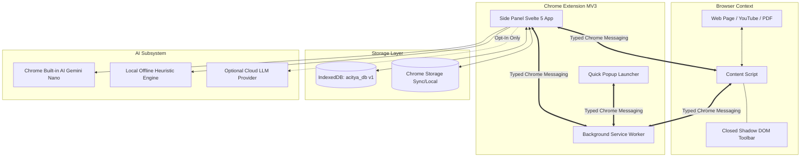
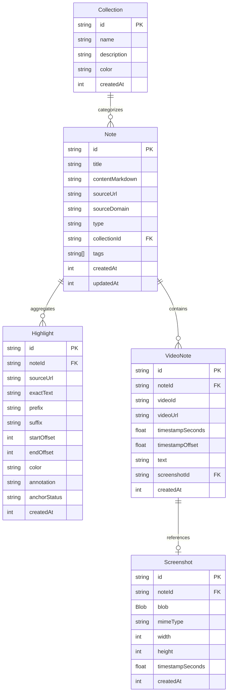
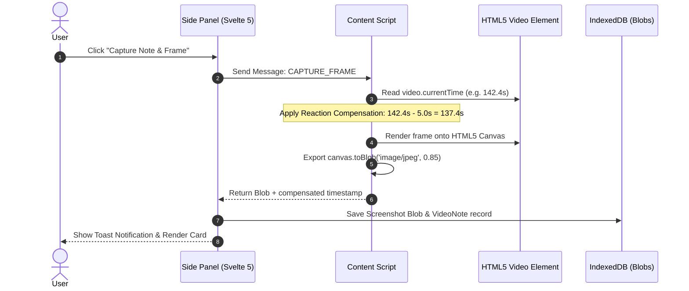
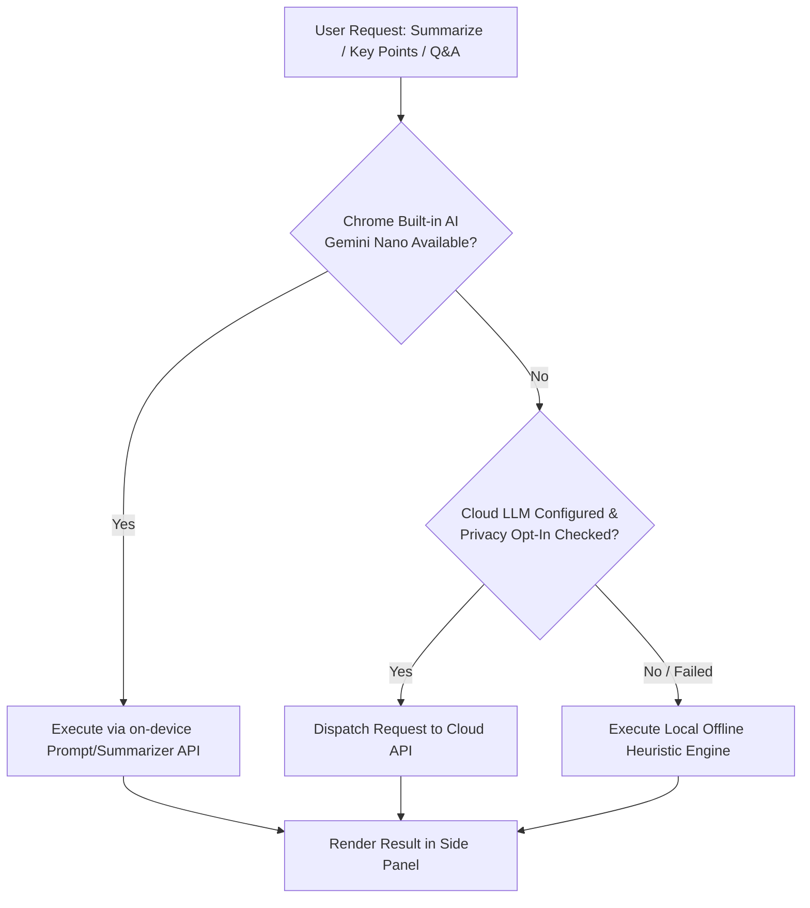

# Anitya (Acitya Notes) — System Architecture Documentation 🏛️

> **Technical Architecture, Data Flow, and Design Principles**  
> *Manifest V3 Chrome Extension · Svelte 5 · Local-First IndexedDB · Isolated Shadow DOM*

---

## 1. System Overview & Philosophy

**Anitya** (historically codenamed *Acitya Notes*) is engineered as a zero-friction, local-first browser companion for knowledge workers, researchers, and students. Its architectural foundation rests on four core pillars:

1. **Local-First & Zero Telemetry**: 100% of user data (notes, highlights, captured video frames, transcripts, and preferences) resides on the user's device in IndexedDB and Chrome Storage.
2. **Context-Preserving Isolation**: Operates without altering or polluting target web pages. Interactive UI components (e.g. the text selection highlighter) are encapsulated within a **Closed Shadow DOM**, preventing style leaks and host script collisions.
3. **W3C Standards Compliance**: Text annotations adhere to the **W3C Web Annotation Data Model**, employing `TextQuoteSelector` (`exact`, `prefix`, `suffix`) and `TextPositionSelector` for resilient text anchoring across dynamic web pages.
4. **Resilient Hybrid Intelligence**: AI operations prioritize on-device Chrome Built-in AI (Gemini Nano) and offline heuristic engines, with an opt-in, privacy-guarded bridge to cloud providers.



---

## 2. Extension Component Boundaries (Manifest V3)

The application follows the modern Chrome Manifest V3 lifecycle specifications managed by the [WXT](https://wxt.dev/) extension framework:

### 2.1 Background Service Worker (`src/entrypoints/background.ts`)
- **Lifecycle**: Event-driven and ephemeral. It wakes on registered events (context menus, shortcut commands, or inter-component messages) and terminates when idle.
- **Responsibilities**:
  - Context menu initialization (`selection`, `page`, and `action` contexts).
  - Window and active tab management with safe fallback querying (`chrome.tabs.query`).
  - Side panel activation via `chrome.sidePanel.open()`.
  - Content script injection triggers.
- **State Guarantee**: Does not maintain long-lived in-memory state. All persistent data flows through IndexedDB or Chrome Storage.

### 2.2 Side Panel Application (`src/entrypoints/sidepanel/`)
- **Host**: Native Chrome Side Panel API (`chrome.sidePanel`).
- **Tech Stack**: [Svelte 5](https://svelte.dev/) with modern Runes (`$state`, `$derived`, `$effect`), TypeScript, and Vanilla CSS design tokens.
- **Responsibilities**:
  - Primary user workspace: Note Editor, Highlight Management, Video Notetaker & Frame Studio, Transcript Viewer, Library Search, and Settings.
  - Non-blocking reactive feedback via `ToastContainer.svelte` and `ConfirmModal.svelte`.
  - Direct read/write operations to IndexedDB via the repository pattern.

### 2.3 Web Content Script (`src/entrypoints/content.ts`)
- **Injection**: Injected into matched web pages (`<all_urls>`).
- **DOM Encapsulation**: Mounts the floating highlight toolbar inside an isolated container:
  ```ts
  const host = document.createElement('acitya-highlighter-root');
  const shadow = host.attachShadow({ mode: 'closed' });
  ```
- **Responsibilities**:
  - Text selection detection (`window.getSelection()`).
  - W3C text quote extraction (`exact`, `prefix`, `suffix`, character offsets).
  - DOM highlight rendering using custom `<mark class="acitya-highlight">` tags.
  - YouTube player observer and video element synchronization.
  - High-resolution HTML5 canvas frame capture.

### 2.4 Quick Action Popup (`src/entrypoints/popup/`)
- Compact 280px popup launcher for single-click page clipping, quick note capture, and direct navigation to the side panel.

---

## 3. Storage Layer & Data Integrity (`acitya_db` v1)

All persistence is managed via [`idb`](https://github.com/jakearchibald/idb) wrapping standard IndexedDB with schema migration support.



### 3.1 Object Stores & Indexes
| Object Store | Primary Key | Key Indexes | Description |
| :--- | :--- | :--- | :--- |
| `notes` | `id` (UUIDv4) | `by-updatedAt`, `by-type`, `by-collection`, `by-sourceUrl` | Central document store for notes & web clips |
| `highlights` | `id` (UUIDv4) | `by-sourceUrl`, `by-noteId`, `by-createdAt` | W3C anchored text highlights |
| `videoNotes` | `id` (UUIDv4) | `by-noteId`, `by-videoId`, `by-timestamp` | Timestamped annotations with reaction offsets |
| `screenshots` | `id` (UUIDv4) | `by-noteId`, `by-createdAt` | Binary frame capture Blobs |
| `transcriptSegments` | `id` (UUIDv4) | `by-videoId`, `by-startMs` | YouTube caption segments |
| `collections` | `id` (UUIDv4) | `by-name`, `by-updatedAt` | Grouping folders/workspaces |
| `settings` | `key` | — | User settings & AI configuration |

### 3.2 Cascaded Deletions & Referential Integrity
To eliminate database leaks and orphaned large binary blobs:
- Deleting a `Note` triggers an atomic transaction across 4 stores (`notes`, `highlights`, `videoNotes`, `screenshots`).
- Child `videoNotes` and associated binary `screenshots` are permanently purged.
- Related `highlights` are disassociated (`noteId = undefined`) without destroying the user's web page annotations.

---

## 4. W3C Web Annotation & DOM Re-Anchoring Engine

Web pages are dynamic; DOM tree modifications, advertisements, and responsive reflows often break simple CSS selectors or XPath paths. Anitya implements the **W3C Web Annotation Data Model**:

### 4.1 Quote Selector Anatomy
```json
{
  "exact": "Informatics is the study of computational systems.",
  "prefix": "According to the department, ",
  "suffix": " Students are required to take...",
  "startOffset": 1042,
  "endOffset": 1092
}
```

### 4.2 Anchoring Algorithm
1. **Direct Search**: Attempt to locate `exact` anchored by `prefix` and `suffix` at approximately `startOffset`.
2. **Context Fallback**: If strict positional matching fails due to DOM changes, scan the document tree using normalized whitespace matching with `prefix` and `suffix` constraints.
3. **Status Assignment**:
   - Success: Applied as an active DOM highlight (`anchorStatus: 'anchored'`).
   - Failure: Preserved in IndexedDB marked as `anchorStatus: 'unresolved'`, allowing the user to view the quote in the Side Panel even if the page has changed drastically.

---

## 5. YouTube Video Notetaking & Frame Capture Subsystem



### 5.1 Human Reaction Time Compensation
When users spot an important insight in a video, their physical reaction time (detecting the idea, reaching for the mouse, and clicking) introduces an inherent delay of 3–7 seconds. Anitya automatically calculates:
$$\text{Compensated Timestamp} = \max(0, \text{currentTime} - \text{offset})$$
The default offset is configurable (default **-5 seconds**).

### 5.2 Two-Way Seeking
Clicking any timestamp `[mm:ss]` in the Side Panel transmits a `SEEK_VIDEO` message to the Content Script, calling `video.currentTime = targetTime` and scrolling the video player into view without triggering a page reload.

---

## 6. Hybrid AI Knowledge Subsystem

The AI subsystem utilizes a 3-tier cascade prioritizing privacy, availability, and capability:



### 6.1 Strict Privacy Guard
Cloud AI is **disabled by default**. Cloud requests are intercepted by `CloudAIProvider.callLlm()`:
```ts
if (!this.settings.optInCloudProcessing) {
  throw new Error('Cloud AI processing is disabled. You must explicitly opt-in in Settings.');
}
```
If disabled or in the event of network failure, execution automatically falls back to `FallbackAIProvider` without leaking user data.

---

## 7. Performance & Security Bounds

1. **Manifest V3 CSP**: Forbids `unsafe-eval` and remote code execution. All bundle code is compiled locally by WXT.
2. **XSS Hardening**: Markdown parsing via `marked` is piped through `DOMPurify` with custom sanitizer hooks enforcing `target="_blank"` and `rel="noopener noreferrer"`.
3. **Memory Footprint**: Content script maintains lightweight DOM observers; closed shadow root eliminates stylesheet re-evaluation costs on the host page.
