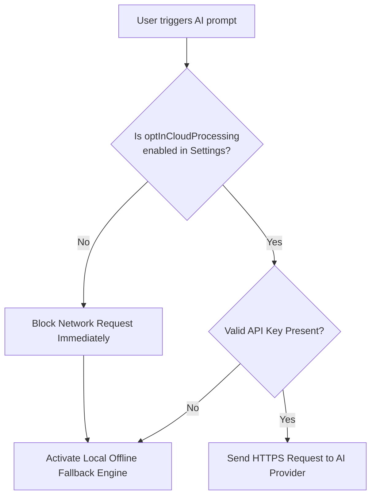

# Anitya (Acitya Notes) — Security & Privacy Architecture 🛡️

> **Security Posture, Threat Modeling, Data Protection, and Privacy Guarantees**  
> *Manifest V3 Compliance · Zero Telemetry · Local-First Data Storage*

---

## 1. Core Security & Privacy Philosophy

Anitya is constructed from the ground up on the principle of **radical data sovereignty**:
- **Zero Third-Party Telemetry**: There are no analytics libraries (e.g. Google Analytics, Mixpanel, Sentry), no user tracking pixels, and no remote crash reporters embedded in the codebase.
- **Local-First Persistence**: Notes, highlights, video frames, and configurations are stored solely on the client machine via browser-native **IndexedDB** (`idb`) and **Chrome Storage Local**.
- **No Remote Code Execution**: Full compliance with Chrome Web Store Manifest V3 requirements—no external scripts, `eval()`, or dynamically executed CDN code.

---

## 2. Threat Modeling & Mitigations

### 2.1 Cross-Site Scripting (XSS) Prevention

| Threat Vector | Potential Impact | Anitya Mitigation Mechanism |
| :--- | :--- | :--- |
| **Malicious Web Clipper Content** | Arbitrary JavaScript execution when rendering clipped page content in Side Panel. | Content scraped via `pageExtractor.ts` passes through `marked` parser and is sanitized by `DOMPurify` before DOM insertion. |
| **Unsafe Markdown Directives** | Execution via `{@html}` blocks in Svelte. | `MarkdownRenderer.svelte` applies strict DOMPurify sanitization. In parser failure scenarios, a custom `escapeHtml()` function neutralizes all HTML entities (`&`, `<`, `>`, `"`, `'`). |
| **Reverse Tabnabbing** | Target web page stealing window focus or redirecting parent window. | All rendered markdown links automatically receive `target="_blank"` and `rel="noopener noreferrer"` via DOMPurify's `afterSanitizeAttributes` hook. |
| **Dangerous Schemes** | Execution via `javascript:` or `data:text/html` URLs. | DOMPurify strips non-standard URL schemes, permitting only `http:`, `https:`, and `mailto:`. |

### 2.2 Content Script Isolation (Shadow DOM)
Content scripts injected into third-party websites present two primary security risks:
1. Host page scripts inspecting or mutating extension input fields.
2. Host page CSS styles breaking or overriding extension interfaces.

**Solution**: The floating highlighter toolbar is injected inside a **Closed Shadow DOM**:
```ts
const host = document.createElement('acitya-highlighter-root');
const shadow = host.attachShadow({ mode: 'closed' });
```
With `mode: 'closed'`, web page scripts cannot access the internal elements via `element.shadowRoot`, ensuring complete isolation.

### 2.3 Strict AI Privacy Guard

Anitya implements an explicit, programmatic gate blocking any automated transmission of user data to third-party AI APIs:



- **Opt-In by Default is False**: Out of the box, `optInCloudProcessing` is `false`.
- **Zero Silent Fallback to Cloud**: If the local Gemini Nano on-device model is unavailable, the system cascades to the **Offline Heuristic Engine** (`fallbackProvider.ts`), which runs completely on the CPU without sending a single byte over the network.
- **Client-Side Secret Storage**: User API keys for Gemini or OpenAI are stored strictly in `chrome.storage.local` with masked password fields in the UI.

---

## 3. Chrome Manifest V3 Security Boundary

### Minimal Privilege Policy
Anitya requests only the absolute minimum permissions necessary to deliver its core functions:

```json
{
  "permissions": [
    "sidePanel",     // To render the main interface alongside web tabs
    "storage",       // To persist user preferences locally
    "activeTab",     // To read the active URL/title upon explicit user clip
    "tabs",          // To coordinate navigation and video seek commands
    "scripting",     // To inject the highlight restoration script
    "contextMenus"   // To provide right-click 'Open Acitya' and 'Clip' actions
  ],
  "host_permissions": [
    "<all_urls>"     // Essential for web clipping and highlighter across any domain
  ]
}
```

### Content Security Policy (CSP)
Manifest V3 enforces a hardened Content Security Policy by default:
- `script-src 'self'`: Disallows external scripts and CDNs.
- Disallows `unsafe-eval`: Prevents string-to-code execution vulnerabilities.

---

## 4. Protected Video & DRM Considerations

When users capture video frames on YouTube:
- Anitya attempts to draw the frame using HTML5 Canvas `context.drawImage()`.
- If a video utilizes **Widevine DRM** or cross-origin restrictions that flag the canvas as *tainted* (`SecurityError: Failed to execute 'toBlob' on 'HTMLCanvasElement'`), Anitya catches the exception gracefully:
  - The error is captured and a polite notification is displayed to the user (`toast.error`).
  - The textual timestamped note is saved normally without corrupting the database.

---

## 5. Data Deletion & Erasure Integrity

To guarantee complete compliance with user data rights (Right to Erasure):
- **Single Note Cascade**: Deleting a note automatically purges all associated video notes, binary screenshot Blobs, and unlinks highlights in an atomic transaction across 4 IndexedDB stores.
- **Factory Reset / Wipe All Data**: Located in Settings. Protected by a challenge phrase requiring the user to type `DELETE`. Once confirmed, all 7 IndexedDB stores are cleared, and `chrome.storage.local` is reset to factory defaults.
